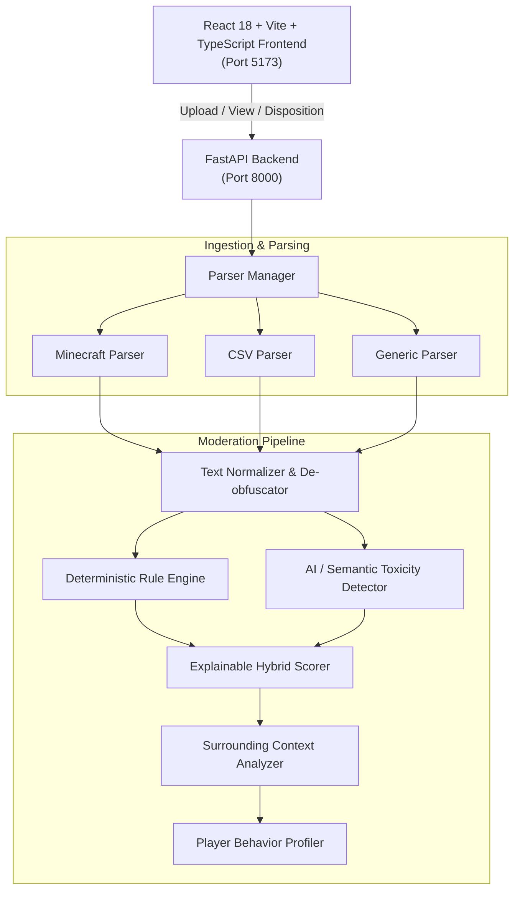

# Chat Log Moderation Analyzer

A production-quality web application designed to assist community and Minecraft server moderators in analyzing historical chat logs. It detects inappropriate behavior, targeted harassment, griefing coordination, threats, and spam, presenting moderators with explainable flagged records, surrounding conversational context, and aggregated player behavior dossiers.

> **Core Philosophy: Human-in-the-Loop Moderation**  
> The system flags and explains suspicious content with transparent confidence scores and plain-English reasons. Moderators make the final decision—no automated bans, kicks, or mutes are performed.

---

## Key Features

- **Extensible Multi-Format Parsing (Phases 1 & 11):**
  - Native support for Minecraft server logs: Vanilla, Paper, Bukkit, Spigot, and Purpur (`[HH:MM:SS INFO]: <Player> Message`, `[Server thread/INFO]`, rank prefix stripping `[Admin]`, whispers).
  - Generic timestamped logs (`[HH:MM:SS] Player: Message`).
  - CSV spreadsheets (`timestamp,player,message`).
- **Deterministic Rule Engine & De-obfuscation (Phase 2):**
  - Unicode NFKD diacritical mark stripping.
  - Leetspeak translation (`1d!0t` $\rightarrow$ `idiot`, `@` $\rightarrow$ `a`, `$` $\rightarrow$ `s`, `0` $\rightarrow$ `o`).
  - Repetition collapse (`baaaad` $\rightarrow$ `baad`).
  - Intra-word separator removal (`i.d.i.o.t` or `i d i o t` $\rightarrow$ `idiot`).
  - Capslock flood, punctuation flood (`????!!!!!`), and character flood spam heuristics.
  - Suspicious URL & external Discord / IP address advertisement detection.
  - **False-Positive Shields:** Substring guards prevent false alarms on harmless words like *grass*, *bass*, *compass*, *assist*, *classic*, *cockpit*, *scrap*, and *hello*.
- **Context-Aware ML/AI Toxicity Detection (Phase 3):**
  - Multi-label classifier scoring: `toxicity`, `harassment`, `personal_attack`, `threat`, `identity_attack`, `sexual`, `severe_toxicity`.
  - Configurable confidence thresholds (`unlikely`, `questionable`, `likely`, `highly_likely`).
  - Pluggable provider architecture with high-fidelity local semantic NLP model that runs offline without external API keys or heavy GPU weights.
- **Explainable Hybrid Scoring (Phase 4):**
  - Dual-engine weighted synthesis combining rule triggers and AI probability.
  - Plain-English bullet-point justifications explaining *why* a message was flagged.
- **Surrounding Context Dialogue Thread (Phase 5):**
  - Extracts the preceding 3 and succeeding 3 messages surrounding any flagged line.
  - Distinguishes isolated remarks, normal disagreements, repeated harassment, and rapid conversational escalation.
- **Player Behavior Dossiers (Phase 6 & 9):**
  - Aggregated per-player metrics: total messages, violation rate, severity breakdowns, average toxicity, common violation categories, and neutral review status tiers (`clean`, `requires_review`, `repeated_flags`, `high_priority_review`).
- **Moderator Dashboard & Detailed Review (Phases 7 & 8):**
  - Searchable, filterable, and sortable flagged message table.
  - Interactive Review Modal: View surrounding dialogue, inspect dual scores, and record moderator dispositions:
    - `Confirm Flag`
    - `False Positive`
    - `Mark as Reviewed`
    - `Ignore`
    - `Moderator Notes`
- **Analytics & Report Exports (Phases 10 & 14):**
  - Visual distribution metrics for severity, categories, top flagged players, and false-positive rates.
  - One-click export of structured moderation reports in **JSON** or **CSV** formats.
- **Modern Polished Interface (Phase 15):**
  - Dark-mode glassmorphic interface with responsive typography (`Inter`, `JetBrains Mono`), glowing status indicators, and keyboard accessibility.

---

## Architecture Overview



---

## Tech Stack

- **Backend:** Python 3.11, FastAPI, Uvicorn, Pydantic v2.
- **Frontend:** React 18, Vite, TypeScript, Lucide Icons, Vanilla CSS with custom modern design tokens.
- **Testing:** Pytest (32 automated unit and integration tests).

---

## Quickstart: Running Locally

### Prerequisites
- Python 3.10+
- Node.js 18+ and npm

### 1. Start the Backend API
```bash
cd backend
python -m pip install -r requirements.txt
python -m uvicorn app.main:app --host 127.0.0.1 --port 8000 --reload
```
The FastAPI backend will start at: `http://127.0.0.1:8000`  
Interactive OpenAPI documentation: `http://127.0.0.1:8000/docs`

### 2. Start the Frontend
```bash
cd frontend
npm install
npm run dev
```
The React frontend will start at: `http://127.0.0.1:5173`

---

## Running the Automated Test Suite

From the project root:
```bash
python -m pytest -v
```
Runs all 32 tests covering:
- Ingestion & multi-format parsers
- Unicode normalization, leetspeak de-obfuscation, and repetition collapse
- Hard-rule violations (slurs, threats, profanity, spam, URLs)
- Scunthorpe problem & false-positive prevention (grass, bass, compass, assist)
- AI multi-label toxicity thresholds
- Hybrid score explainability & reason synthesis
- Surrounding context window extraction & dialogue escalation
- Player behavioral profiling & disposition action persistence

---

## API Reference Summary

| Method | Endpoint | Description |
| :--- | :--- | :--- |
| `GET` | `/api/v1/health` | Service health status |
| `POST` | `/api/v1/upload` | Multipart chat-log file upload (`.log`, `.txt`, `.csv`) |
| `GET` | `/api/v1/sample` | Load built-in interactive sample log |
| `GET` | `/api/v1/messages/{id}/context` | Surrounding preceding/succeeding dialogue messages |
| `POST` | `/api/v1/messages/{id}/action` | Submit moderator disposition action & notes |
| `GET` | `/api/v1/players` | Aggregated behavioral dossiers for all players |
| `GET` | `/api/v1/players/{username}` | Detailed player profile & message history |
| `GET` | `/api/v1/analytics/summary` | Global severity distributions & false-positive metrics |
| `GET` | `/api/v1/export/report?format=json|csv` | Export moderation findings as JSON or CSV |

---

## License
MIT License. Built for community and server moderation assistance.
